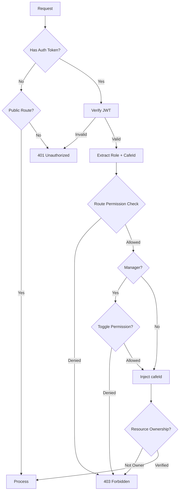

# Phase 0: Permission Matrix & Access Control

- **Document Version:** 1.0.0
- **Status:** Approved / Core Specification
- **Target Platform:** Cafe QR Ordering, Staff Operations & Platform Administration

---

## 1. Roles Overview

The system operates on a multi-tier, multi-tenant Role-Based Access Control (RBAC) model. Access is partitioned across three administrative planes: Platform Administration, Cafe Staff Operations, and Public Customer Ordering.

| Role | Surface | Auth Method | Scope | Token Type / Expiry |
| :--- | :--- | :--- | :--- | :--- |
| `super_admin` | Admin Panel | Email + Password + Mandatory 2FA (TOTP) | Platform-wide (Cross-tenant) | Short-lived JWT (15m) + Rotating Refresh Token (7d) |
| `owner` | Staff Dashboard | Email + Password (+ 2FA Optional) | Single Cafe (Full ownership) | Short-lived JWT (30m) + Rotating Refresh Token (30d) |
| `manager` | Staff Dashboard (Limited) | Email + Password | Single Cafe (Scoped by permission toggles) | Short-lived JWT (30m) + Rotating Refresh Token (14d) |
| `chef` | Kitchen Display System (KDS) | Dedicated Cafe Station Login / Account | Single Cafe (Kitchen & Order preparation) | Station JWT (12h auto-refresh with active heartbeat) |
| `waiter` | Waiter Screen / Handheld | Staff Account or Quick PIN (4–6 digits) | Single Cafe (Assigned or active tables) | Staff JWT / PIN Session (12h auto-refresh) |
| `customer` | Mobile Web App (PWA) | QR Scan + Phone OTP + Unique Device Token | Single Cafe Table Session | Ephemeral Session JWT bound to Table & Device (4h) |

---

## 2. Permission Matrix

The following matrix details the operational capabilities for every endpoint group across all defined roles.

### Legend
- ✅ **Full Access:** Unrestricted execution within the role's assigned tenant scope.
- ✅ *condition*: Conditional access explicitly described.
- 🔧 *toggle_name*: Requires the specific manager permission toggle to be enabled by the Cafe Owner.
- 👁️ *scope*: Read-only access limited to the indicated boundary.
- ❌ **Forbidden:** Explicitly blocked at middleware level (returns `403 Forbidden`).

---

| Endpoint Group | `super_admin` | `owner` | `manager` | `chef` | `waiter` | `customer` |
| :--- | :---: | :---: | :---: | :---: | :---: | :---: |
| **Auth - Login/Register** | ✅ | ✅ | ✅ | ✅ | ✅ | (OTP) |
| **Cafe Profile - Read** | ✅ all | ✅ own | ✅ own | ❌ | ❌ | 👁️ public |
| **Cafe Profile - Edit** | ✅ | ✅ | ❌ | ❌ | ❌ | ❌ |
| **Documents - Upload** | ❌ | ✅ | ❌ | ❌ | ❌ | ❌ |
| **Documents - View** | ✅ | ✅ own | ❌ | ❌ | ❌ | ❌ |
| **Verification** | ✅ | ❌ | ❌ | ❌ | ❌ | ❌ |
| **Categories CRUD** | ✅ | ✅ | 🔧 `can_edit_menu` | ❌ | ❌ | ❌ |
| **Items CRUD** | ✅ | ✅ | 🔧 `can_edit_menu` | ❌ | ❌ | ❌ |
| **Option Groups CRUD** | ✅ | ✅ | 🔧 `can_edit_menu` | ❌ | ❌ | ❌ |
| **Tables CRUD** | ✅ | ✅ | 🔧 `can_manage_tables` | ❌ | ❌ | ❌ |
| **QR Generation** | ✅ | ✅ | 🔧 `can_manage_tables` | ❌ | ❌ | ❌ |
| **Staff CRUD** | ✅ | ✅ | 🔧 `can_manage_staff` *(waiter/chef only)* | ❌ | ❌ | ❌ |
| **Offers CRUD** | ✅ | ✅ | 🔧 `can_manage_offers` | ❌ | ❌ | ❌ |
| **Settings Edit** | ✅ | ✅ | 🔧 `can_manage_settings` | ❌ | ❌ | ❌ |
| **Settings View** | ✅ | ✅ | ✅ | ❌ | ❌ | ❌ |
| **Subscription View** | ✅ | ✅ | ❌ | ❌ | ❌ | ❌ |
| **Subscription Edit** | ✅ | ❌ *(pay only)* | ❌ | ❌ | ❌ | ❌ |
| **Plans CRUD** | ✅ | ❌ | ❌ | ❌ | ❌ | ❌ |
| **Revenue/Charts** | ✅ all | ✅ own | 🔧 `can_see_daily_total` | ❌ | ❌ | ❌ |
| **Reports Export** | ✅ | ✅ | 🔧 `can_view_reports` | ❌ | ❌ | ❌ |
| **Orders - View incoming** | ✅ | ✅ | ✅ | ❌ | 👁️ own tables | ❌ |
| **Orders - Approve/Reject** | ✅ | ✅ | ✅ | ❌ | ❌ | ❌ |
| **Orders - Place** | ❌ | ❌ | ❌ | ❌ | ✅ *(add to session)* | ✅ |
| **Kitchen - View dishes** | ✅ | ✅ | ✅ | ✅ | ❌ | ❌ |
| **Kitchen - Update status** | ❌ | ✅ *(override)* | ✅ *(if kitchen_mode OFF)* | ✅ | ❌ | ❌ |
| **Kitchen - Undo** | ❌ | ✅ | ✅ | ✅ *(own only)* | ❌ | ❌ |
| **Waiter - View calls** | ✅ | ✅ | ✅ | ❌ | ✅ | ❌ |
| **Waiter - Acknowledge/Resolve** | ❌ | ✅ | ✅ | ❌ | ✅ | ❌ |
| **Waiter - Mark served** | ❌ | ✅ | ✅ | ❌ | ✅ | ❌ |
| **Bills - Create/Settle** | ❌ | ✅ | ✅ | ❌ | ❌ | ❌ |
| **Bills - Void** | ❌ | ✅ | 🔧 `can_issue_refunds` | ❌ | ❌ | ❌ |
| **Refunds** | ❌ | ✅ | 🔧 `can_issue_refunds` | ❌ | ❌ | ❌ |
| **Business Day Start/End** | ❌ | ✅ | ✅ | ❌ | ❌ | ❌ |
| **Cash Reconciliation** | ❌ | ✅ | ❌ | ❌ | ❌ | ❌ |
| **Table Grid** | ✅ | ✅ | ✅ | ❌ | ✅ | ❌ |
| **Session - Join/View** | ❌ | ❌ | ❌ | ❌ | ❌ | ✅ own |
| **Cart - Shared** | ❌ | ❌ | ❌ | ❌ | ❌ | ✅ own session |
| **Customer - View menu** | ❌ | ❌ | ❌ | ❌ | ❌ | ✅ |
| **Customer - Order status** | ❌ | ❌ | ❌ | ❌ | ❌ | ✅ own |
| **Customer - Pay** | ❌ | ❌ | ❌ | ❌ | ❌ | ✅ own bill |
| **Customer - Waiter call** | ❌ | ❌ | ❌ | ❌ | ❌ | ✅ |
| **Audit Log** | ✅ | ❌ | ❌ | ❌ | ❌ | ❌ |
| **Announcements** | ✅ | ❌ | ❌ | ❌ | ❌ | ❌ |
| **Platform Settings** | ✅ | ❌ | ❌ | ❌ | ❌ | ❌ |
| **Support Tickets** | ✅ all | ✅ create/own | ❌ | ❌ | ❌ | ❌ |
| **Impersonate** | ✅ read-only | ❌ | ❌ | ❌ | ❌ | ❌ |

---

## 3. Manager Permission Toggles

Managers are designed as flexible delegates of the Cafe Owner. By default, a newly created manager has the minimum operational baseline (order management and basic operations) with all administrative and financial privileges disabled.

The Cafe Owner may toggle these individual permissions at any time via the Staff Management interface.

| Toggle Key | Default | Feature & Endpoint Controls | Guardrails & Restrictions |
| :--- | :---: | :--- | :--- |
| `can_edit_menu` | `false` | Categories, items, option groups, modifiers, taxes, and pricing (CRUD). | Cannot alter platform-defined tax templates if locked by platform. |
| `can_manage_tables` | `false` | Add/edit/delete tables, assign zones, generate and download table QR codes. | Cannot exceed plan-defined table count limits. |
| `can_manage_offers` | `false` | Create, activate, deactivate, and modify discounts, coupons, and promo banners. | Max discount percentage capped to owner-defined threshold. |
| `can_see_daily_total` | `false` | Displays today's gross and net revenue metrics on the staff dashboard header/widgets. | Historical charts and multi-month analytics remain hidden. |
| `can_issue_refunds` | `false` | Process transaction refunds, approve item voids on active or settled bills. | Refunds above configured limit (\$50 / equivalent) mandate owner OTP/PIN. |
| `can_manage_staff` | `false` | Create, update, deactivate staff accounts and assign waiter table sections. | **Strictly prohibited** from creating/editing owners or other managers. Cannot alter own permissions. |
| `can_view_reports` | `false` | Access reports dashboard, sales summaries, item sales velocity, and CSV/PDF export. | Excludes raw owner banking details and payout statements. |
| `can_manage_settings` | `false` | Update cafe operational hours, kitchen prep times, auto-accept toggles, notifications. | **Cannot** view or modify billing, plan subscription, or payout accounts. |

### Technical Schema for Manager Toggles
Manager permissions are stored as a structured JSONB object or boolean columns on the `cafe_staff` entity:

```json
{
  "staff_id": "stf_01HXYZ9012JKLM",
  "cafe_id": "cfe_01HABC1234DEFG",
  "role": "manager",
  "permissions": {
    "can_edit_menu": false,
    "can_manage_tables": false,
    "can_manage_offers": false,
    "can_see_daily_total": false,
    "can_issue_refunds": false,
    "can_manage_staff": false,
    "can_view_reports": false,
    "can_manage_settings": false
  }
}
```

---

## 4. Middleware Execution & Request Pipeline

Every incoming HTTP and WebSocket connection passes through an immutable pipeline of validation, authentication, authorization, and tenant isolation middleware before reaching route controllers.

### Middleware Flowchart



---

## 5. Security Enforcement Rules

The access control architecture mandates strict compliance with the following 17 security enforcement rules across all backend services:

### 1. Tenant Isolation via Middleware
- **Principle:** Every database query involving cafe data must be strictly scoped to `cafe_id`.
- **Implementation:**
  - After verifying the JWT, the `TenantContextMiddleware` extracts `cafe_id` from the token and injects it into the request context (e.g., `req.tenant.cafeId`).
  - ORM/Database repositories automatically apply `WHERE cafe_id = :tenantCafeId` to all `SELECT`, `UPDATE`, and `DELETE` queries.
  - Route handlers are never permitted to read `cafe_id` from unverified user input (`req.body` or `req.query`).

### 2. RBAC Middleware Chain
- **Principle:** Strict hierarchical evaluation where unauthenticated or unauthorized calls fail immediately.
- **Implementation:**
  - Order: `AuthGuard` -> `RoleGuard(allowedRoles)` -> `ManagerToggleGuard(requiredToggle)` -> `OwnershipGuard`.
  - Failures immediately return RFC 7807 compliant JSON problem details (`401` or `403`) with zero information disclosure.

### 3. IDOR (Insecure Direct Object Reference) Prevention
- **Principle:** Possession of an entity's primary UUID must never allow unauthorized access across cafe boundaries.
- **Implementation:**
  - Every resource lookup (e.g., `/api/v1/orders/:orderId`) executes a compound query:
    ```sql
    SELECT * FROM orders WHERE id = :orderId AND cafe_id = :tenantCafeId;
    ```
  - If the entity exists under a different tenant, the response returns `404 Not Found` (rather than `403 Forbidden`) to prevent resource enumeration attacks.

### 4. Cryptographically Signed Table Tokens
- **Principle:** QR codes must prevent tampering, coordinate spoofing, and unauthorized table hopping.
- **Implementation:**
  - QR codes encode an HMAC-SHA256 signed token containing `cafe_id`, `table_id`, `table_number`, `generation_version`, and `exp`.
  - The signature is calculated using the cafe's unique secret salt concatenated with platform master key:
    $$\text{HMAC-SHA256}(\text{cafe\_id} \parallel \text{table\_id} \parallel \text{version}, K_{\text{cafe\_secret}})$$
  - Regenerating a table's QR code increments `generation_version`, instantly invalidating previously printed physical codes.

### 5. Customer Session Binding
- **Principle:** Prevent malicious actors from intercepting carts, hijacking bills, or placing unauthorized orders on behalf of other diners.
- **Implementation:**
  - Upon scanning a valid table QR and completing OTP verification, an ephemeral Customer Session is created in Redis.
  - The session binds: `session_id`, `cafe_id`, `table_id`, `phone_hash`, and `device_fingerprint_token` (stored in `HttpOnly`, `SameSite=Strict` cookie).
  - Subsequent cart actions and orders must present both the Session JWT and matching device token; mismatches force re-verification.

### 6. Mass-Assignment & DTO Strict Whitelisting
- **Principle:** Prevent privilege escalation and accidental overwrite of critical tenant fields.
- **Implementation:**
  - Strict input validation using schema validators (e.g., Zod / Class-Validator) with `stripUnknown: true` and `forbidNonWhitelisted: true`.
  - Sensitive internal columns (`id`, `cafe_id`, `created_at`, `subscription_tier`, `is_verified`, `role`) are barred from incoming mutation payloads.

### 7. Tiered Rate Limiting
- **Principle:** Protect sensitive auth endpoints, kitchen displays, and customer routes from brute-force and Denial-of-Service attacks.
- **Implementation:**
  - Handled via Redis token bucket rate limiters:
    - **Customer Phone OTP:** Maximum 3 requests per 10 minutes per phone number/IP.
    - **Staff Password / PIN Login:** Maximum 5 attempts per 15 minutes per username before temporary lockout.
    - **Public Menu & QR Scan:** 120 requests per minute per IP.
    - **Standard Authenticated Staff Endpoints:** 600 requests per minute per cafe.

### 8. Authentication Hardening & Password Security
- **Principle:** Zero plaintext storage and resistance to rainbow tables, credential stuffing, and offline attacks.
- **Implementation:**
  - Staff and Admin passwords hashed using **Argon2id** (memory: 64MB, iterations: 3, parallelism: 4).
  - Minimum password policy: 10 characters, including upper, lower, digit, and symbol.
  - Account lockout: 5 consecutive failed attempts trigger a 15-minute freeze, recorded in security event logs.

### 9. Token Architecture & Rotation
- **Principle:** Minimized blast radius for stolen credentials with instant revocation capability.
- **Implementation:**
  - Access tokens are short-lived (15–30 minutes) stateless JWTs signed with asymmetric RS256/Ed25519 keys.
  - Refresh tokens are cryptographically random 256-bit opaque strings stored hashed in Redis with family tracking.
  - Using a compromised refresh token invalidates the entire token family immediately, terminating all active sessions for that user.

### 10. Kitchen / KDS Access Integrity
- **Principle:** Prevent race conditions, duplicate food preparation, and state corruption across simultaneous chef screens.
- **Implementation:**
  - Dish status updates (`PENDING` -> `PREPARING` -> `READY`) implement distributed optimistic locking via Redis.
  - Dish "Claim" locks ensure that only one chef can mark a dish in preparation.
  - "Undo" functionality is time-bounded (e.g., within 60 seconds of transition) and restricted to the chef station that executed the status change.

### 11. Waiter Table Assignment Scoping
- **Principle:** Prevent staff confusion and ensure targeted service notifications.
- **Implementation:**
  - Waiter screen queries are scoped to tables assigned to that waiter's section.
  - Waiters can place orders or add items exclusively to active table sessions within their assigned section (or cafe-wide if floater mode is enabled by Owner).

### 12. Financial Action Safeguards
- **Principle:** Zero financial discrepancies, phantom bills, or unauthorized cash leakages.
- **Implementation:**
  - Bill settlement requires a database transaction with row-level locking (`SELECT ... FOR UPDATE`) to eliminate double-settlement race conditions.
  - Bill voids and refund actions create an immutable `financial_audit` record containing the initiator, reason code, manager override token (if applicable), and snapshot of items voided.
  - End-of-Day cash reconciliation is restricted strictly to the Cafe Owner.

### 13. Super Admin Impersonation Safety
- **Principle:** Enable platform support without violating tenant data integrity or privacy standards.
- **Implementation:**
  - Super admin impersonation of a cafe is **strictly read-only**.
  - All mutating endpoints (`POST`, `PUT`, `PATCH`, `DELETE`) automatically block requests bearing an `impersonation: true` claim in the JWT.
  - Every impersonation session requires a mandatory Support Ticket ID and is recorded in the platform-wide immutable audit trail.

### 14. Comprehensive Audit Logging
- **Principle:** Complete traceability of critical security, operational, and financial events.
- **Implementation:**
  - Sensitive events (logins, role changes, toggle updates, menu price edits, table QR regeneration, refunds, voids) emit an immutable audit log.
  - Audit record payload:
    ```json
    {
      "timestamp": "2026-11-22T00:38:17Z",
      "actor_id": "usr_01H...",
      "actor_role": "owner",
      "cafe_id": "cfe_01H...",
      "action": "STAFF_TOGGLE_UPDATE",
      "target_resource": "staff:stf_01H...",
      "changes": { "can_edit_menu": { "old": false, "new": true } },
      "ip_address": "203.0.113.195",
      "user_agent": "Mozilla/5.0..."
    }
    ```

### 15. Input Sanitization, Injection & XSS Controls
- **Principle:** All user inputs (such as category names, dish notes, customer special requests) must be sanitized.
- **Implementation:**
  - HTML tags and script injections are stripped via standard sanitization pipelines.
  - Parameterized SQL queries throughout to eliminate SQL injection vulnerabilities.
  - Strict Content Security Policy (CSP) headers enforced on customer web apps and staff dashboards.

### 16. CORS & Transport Security
- **Principle:** Block cross-origin exploitation and credential sniffing.
- **Implementation:**
  - Enforce HTTPS exclusively with HSTS (`max-age=31536000; includeSubDomains; preload`).
  - CORS strictly configured to trusted client origins (admin domain, staff portal domain, customer app domain); wildcards (`*`) are disallowed for credentialed endpoints.

### 17. Webhook & Payment Gateway Verification
- **Principle:** Prevent spoofed order payments or fake settlement confirmations.
- **Implementation:**
  - Payment gateway webhooks (e.g., Stripe, Razorpay) are verified using raw body cryptographic signatures (HMAC with gateway secret).
  - Timestamps are validated to prevent replay attacks (maximum drift: 300 seconds).

---

## 6. Standard Error Responses

To prevent information leakage and timing attacks, the system outputs uniform error payloads following RFC 7807 specifications:

### 401 Unauthorized (Missing or Invalid Authentication)
```json
{
  "type": "https://api.cafeqr.com/errors/unauthorized",
  "title": "Unauthorized",
  "status": 401,
  "detail": "Authentication credentials are missing, expired, or invalid.",
  "instance": "/api/v1/orders/live"
}
```

### 403 Forbidden (Insufficient Permissions or Toggle Disabled)
```json
{
  "type": "https://api.cafeqr.com/errors/forbidden",
  "title": "Forbidden",
  "status": 403,
  "detail": "You do not have permission to perform this action. Required permission: can_edit_menu.",
  "instance": "/api/v1/menu/items"
}
```

### 404 Not Found (Cross-Tenant Access / IDOR Trap)
```json
{
  "type": "https://api.cafeqr.com/errors/not-found",
  "title": "Not Found",
  "status": 404,
  "detail": "The requested resource could not be found.",
  "instance": "/api/v1/orders/ord_99887766"
}
```
*(Returned instead of 403 when attempting to access another cafe's entity by ID to prevent resource enumeration).*
